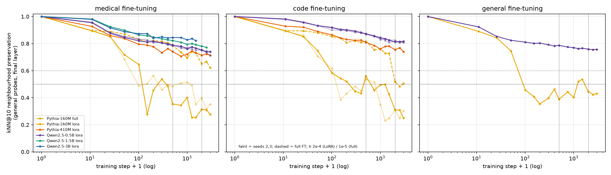
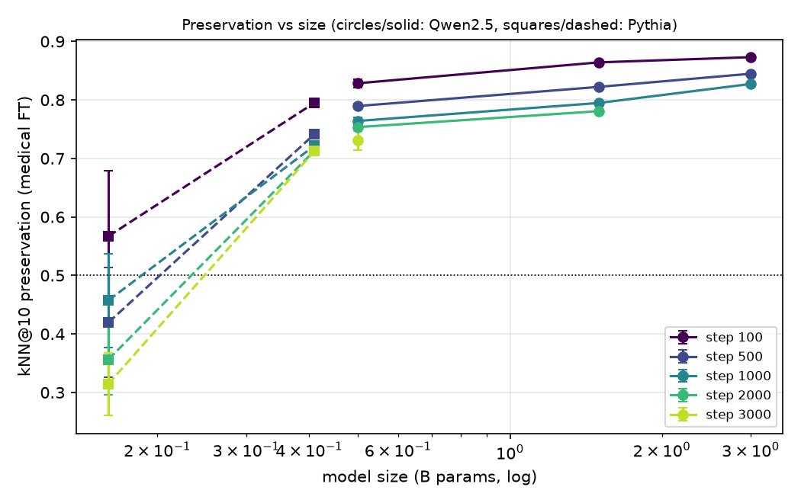
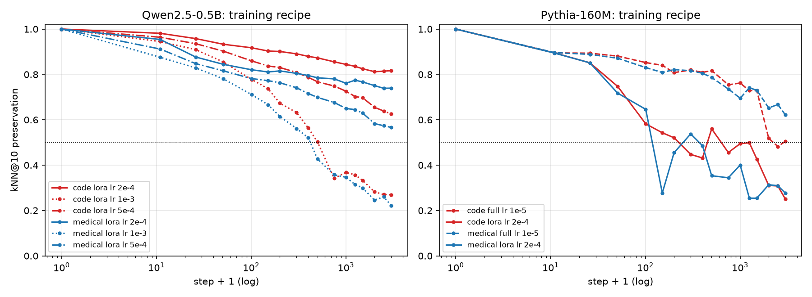
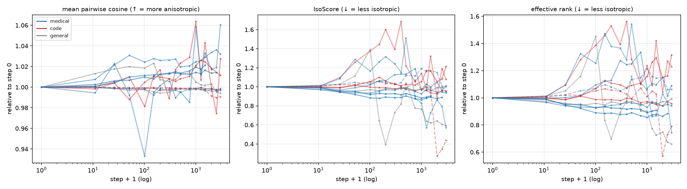
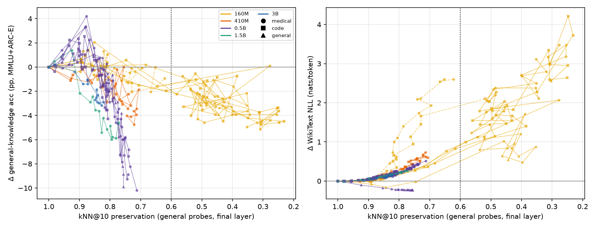

# Embedding-Space Drift Under Fine-Tuning: How Quickly Models Forget Their Pretraining Geometry

## 1. Executive Summary

**Question.** How fast does domain fine-tuning destroy the local neighbourhood structure of a pretrained LM's
representation space? Does that speed depend on model scale and on the fine-tuning domain? And can neighbourhood
loss serve as an early warning of catastrophic forgetting?

**What we did.** We analysed 22 fine-tuning runs:
- 5 base models from 160M to 3B parameters, in two families (Qwen2.5-0.5B/1.5B/3B, Pythia-160M/410M);
- medical, code and general-text (control) domains;
- up to 3,000 steps, with 3 seeds for the main Qwen-0.5B conditions and 2 for Pythia-160M;
- learning-rate (2e-4 / 5e-4 / 1e-3) and full-fine-tuning ablations.

Each run was evaluated at 17 checkpoints on:
- k-nearest-neighbour (kNN) preservation of 1,000 held-out general-text probes;
- CKA and three isotropy measures;
- general knowledge (GK: MMLU + ARC-Easy, 1,070 items, item-level paired tests);
- WikiText and in-domain perplexity.

**Verdict on the hypothesis.** None of the four parts holds as stated.

| Part | Verdict | Key evidence |
|---|---|---|
| **H1** <50 % preservation within 500 steps for sub-1B; 2,000+ steps for 7B | **Partly supported in direction, not in specifics.** | Bigger models drift less at matched steps: medical FT at step 500 gives 0.42 (Pythia-160M), 0.74 (410M), 0.79 (Qwen-0.5B), 0.82 (1.5B), 0.85 (3B). Only Pythia-160M crossed 0.5 within 500 steps (~90–220). Qwen2.5-0.5B never went below 0.71 in 3,000 steps at the standard LoRA lr. The crossing is set mainly by **update size / training stability**: the same 0.5B model ended at 0.73, 0.57 and 0.22 with lr 2e-4, 5e-4 and 1e-3, and crossed 0.5 at ~420–500 steps at lr 1e-3. **Every run that ended below 0.5 was one where held-out in-domain loss rose (optimisation instability).** 7B could not be run (shared GPUs; §6). |
| **H2** isotropy falls monotonically | **Not supported.** | 0/22 runs monotone on any of 3 measures. Net change is small and non-monotone (median IsoScore −8 %, effective rank −6 %, mean cosine +2 %). Pythia-160M first becomes *more* isotropic. |
| **H3** GK accuracy starts dropping when preservation < 60 % | **Not supported as a threshold.** | Preservation correlates with forgetting overall (Spearman ρ = 0.69 with ΔGK; ρ = −0.90 with ΔWikiText-NLL). But Qwen models show significant GK declines (McNemar p < .05) while preservation is still 0.77–0.90. Qwen-0.5B at lr 5e-4 lost 12 pp GK by step 500 at preservation 0.70. The preservation→forgetting mapping differs a lot between families and recipes. |
| **H4** medical preserves more than code (vocabulary overlap) | **Not supported; the reverse holds for most models.** | Medical − code preservation at 144 matched checkpoints = −0.043, with medical higher at only 17 % (Wilcoxon p = 3e-12). Medical also caused more GK and perplexity forgetting. This held even though clinical notes are lexically much closer to general text than code is (JSD 0.45 vs 0.63 bits). Only Pythia-160M followed H4's direction. Major caveat: code fine-tuning **did not lower code loss** (the base models already model code well), so "code preserves more" partly means "code fine-tuning changed less". |

**Practical implication.** kNN preservation on a fixed probe set is cheap and label-free, and it tracks damage to
general-text language modelling closely. But a fixed 60 % alarm would fire far too late: in Qwen models,
benchmark forgetting starts at ≈ 0.8 preservation. Sharp early drops in preservation mainly flag unstable
training, such as too large a learning rate. They do not mark a universal forgetting threshold.

## 2. Research Question & Motivation

Fine-tuning a pretrained LM on a narrow domain improves in-domain performance but erodes general abilities
(catastrophic forgetting). Running benchmarks at every checkpoint is expensive. Probing the *geometry* of
representations on a fixed set of texts is cheap and needs no labels. If geometric drift reliably precedes
forgetting, it would make a practical monitor.

The hypothesis under test had four parts:
1. Preservation < 50 % within 500 steps for sub-1B models, but only after 2,000+ steps for 7B models.
2. Isotropy decreases monotonically.
3. Accuracy starts to decline once preservation < 60 %.
4. Medical fine-tuning preserves more structure than code because of greater vocabulary overlap with
   pretraining data.

**Related work and gap.** No literature review was pre-gathered for this workspace (the resource-finder stage was
skipped), so this section rests on background knowledge. Prior work studies representation similarity after
fine-tuning (Merchant et al. 2020; CKA, Kornblith et al. 2019), anisotropy of contextual embeddings
(Ethayarajh 2019; Mu & Viswanath 2018; IsoScore, Rudman et al. 2022), and forgetting under LLM fine-tuning
(Luo et al. 2023; Kalajdzievski 2024; Biderman et al. 2024 "LoRA learns less and forgets less"). Most of that work
reports end states. This study is **step-resolved** (17 checkpoints). It links local neighbourhood structure to
item-level forgetting tests across scale, domain and recipe, and it checks training health explicitly.

## 3. Experimental Setup

### Models
All are base (non-instruct) checkpoints:
- **Qwen2.5:** 0.5B, 1.5B, 3B (one tokenizer and pretraining corpus);
- **Pythia:** 160M, 410M, trained on the Pile; a second sub-1B family.

Qwen2.5-7B was downloaded and started but could not be completed (§6).

### Standard recipe (identical for every size)
- **Method:** LoRA with r = 64, α = 128, no dropout, on every linear layer (Qwen: q/k/v/o/gate/up/down; Pythia:
  query_key_value, dense, dense_h_to_4h, dense_4h_to_h).
- **Optimiser:** AdamW, β = (0.9, 0.95), lr 2e-4, 50-step warm-up then constant, gradient clipping at 1.0, no
  weight decay.
- **Batch and length:** batch 4 × 512 tokens (2,048 tokens/step), 3,000 steps (6.1M tokens).
- **Precision:** bf16 weights with gradient checkpointing. The loss is computed in 256-token chunks with
  recomputation so the run fits 2–5 GB GPU slices.

### Ablations
- **Learning rate:** Qwen2.5-0.5B LoRA at lr 5e-4 and 1e-3, medical and code.
- **Full fine-tuning:** Pythia-160M with fp32 master weights, bf16 autocast, lr 1e-5, medical and code.
- **Seeds:** 1–3 for Qwen-0.5B medical and code; 1–2 for Pythia-160M medical and code; 1 elsewhere. The seed
  controls document order and LoRA initialisation.

### Fine-tuning corpora
Texts are joined with EOS and cut into 512-token chunks; each run uses a seeded ~6.1M-token prefix.
- **Medical:** Asclepius synthetic clinical notes (40k unique notes).
- **Code:** Python files from codeparrot-clean-valid (30k files, 800–20k characters, not auto-generated).
- **General (control):** WikiText-103 train paragraphs. This control separates "being fine-tuned at all" from
  "domain shift".

### Probe and evaluation sets
All are fixed and disjoint from training data (`src/prep_data.py`).
- **Primary probes:** 1,000 WikiText-103 test/validation paragraphs, truncated to 128 tokens. Secondary probes:
  300 medical and 300 code held-out documents.
- **Representation:** hidden states mean-pooled over positions ≥ 1 (position 0 is an attention sink), at the
  middle and final (post-norm) layer.
- **General knowledge:**
  - MMLU: 570 questions (10 per subject), 0-shot, argmax of the log-probabilities of " A".." D".
  - ARC-Easy: 500 test questions, acc_norm.
  - GK = pooled accuracy over all 1,070 items.
- **Language modelling:** NLL per token on 64 × 512 held-out tokens of WikiText (general) and of in-domain text.

### Metrics (`src/metrics.py`)
All are computed against step 0.
- **kNN preservation@k:** the mean, over probes, of |N_k^step0(i) ∩ N_k^t(i)| / k, using cosine similarity, with
  k ∈ {5, 10, 20} (primary k = 10). We also compute a mean-centred variant.
- **Linear CKA.**
- **Isotropy:** mean pairwise cosine (higher = more anisotropic), IsoScore, and effective rank of the covariance.

### Statistics (`src/analyze.py`)
- **Crossings:** linear interpolation in log(1 + step).
- **Forgetting:** exact McNemar test on the 1,070 items, each checkpoint against step 0.
- **H2:** Spearman correlation with step, and the share of checkpoint transitions that move toward anisotropy.
- **H3:** Mann–Whitney U and Spearman tests.
- **H4:** paired Wilcoxon test over checkpoints matched on (model, method, variant, seed, step).
- **Training health:** a run counts as *learned* if final in-domain NLL < step-0 NLL − 0.05, as *diverged* if
  it is > step-0 + 0.25, and as *no gain* otherwise.

### Hardware and timing
- 4× RTX A6000 (48 GB), heavily shared with other users (usually 2–6 GB free per GPU). No API calls were made.
- Pythia-160M runs took ~7–10 min and Qwen-0.5B runs ~20–26 min.
- Qwen-1.5B/3B ran at 2.9–4.6 s/step plus 4–6 min per evaluation on a GPU shared with another user's job.
  When frozen at 15:45 they had reached steps 2,500 and 1,500.
- Software: Python 3.12.12, torch 2.14.1+cu130, transformers 5.20.2, peft 0.21.2, numpy 2.5.4, scipy 1.18.1,
  pandas 3.1.0.

## 4. Results

### 4.1 H1 – Neighbourhood preservation by scale and step

kNN@10 preservation of general probes at the final layer. Values are means over seeds; sd across the three
Qwen-0.5B seeds is ≤ 0.016.

| Model (recipe) | Domain | step 10 | 100 | 500 | 1000 | 2000 | 3000 | crosses 0.5 at | training |
|---|---|---|---|---|---|---|---|---|---|
| Pythia-160M LoRA 2e-4 (2 seeds) | medical | 0.89 | 0.57 | **0.42** | 0.46 | 0.36 | 0.31 | ~96–117 | diverged |
| Pythia-160M LoRA 2e-4 (2 seeds) | code | 0.89 | 0.60 | 0.55 | 0.42 | 0.31 | 0.28 | ~123–224 | diverged |
| Pythia-160M LoRA 2e-4 | general | 0.89 | 0.46 | 0.39 | 0.40 | 0.45 | 0.43 | ~90 | diverged |
| Pythia-160M full FT 1e-5 | medical | 0.90 | 0.83 | 0.79 | 0.70 | 0.65 | 0.62 | never | learned |
| Pythia-160M full FT 1e-5 | code | 0.90 | 0.85 | 0.82 | 0.76 | 0.52 | 0.51 | (~2,240) | no gain |
| Pythia-410M LoRA 2e-4 | medical | 0.93 | 0.80 | 0.74 | 0.72 | 0.71 | 0.71 | never | learned |
| Pythia-410M LoRA 2e-4 | code | 0.93 | 0.87 | 0.81 | 0.76 | 0.76 | 0.74 | never | diverged (+0.28) |
| Qwen2.5-0.5B LoRA 2e-4 (3 seeds) | medical | 0.96 | 0.83 | 0.79 | 0.76 | 0.75 | 0.73 | never | learned |
| Qwen2.5-0.5B LoRA 2e-4 (3 seeds) | code | 0.98 | 0.91 | 0.87 | 0.84 | 0.82 | 0.81 | never | no gain |
| Qwen2.5-0.5B LoRA 2e-4 | general | 0.92 | 0.81 | 0.79 | 0.77 | 0.76 | 0.76 | never | learned |
| Qwen2.5-0.5B LoRA **5e-4** | medical | 0.91 | 0.78 | 0.70 | 0.65 | 0.58 | 0.57 | never | learned |
| Qwen2.5-0.5B LoRA **5e-4** | code | 0.96 | 0.86 | 0.77 | 0.73 | 0.66 | 0.63 | never | diverged |
| Qwen2.5-0.5B LoRA **1e-3** | medical | 0.88 | 0.71 | 0.43 | 0.35 | 0.25 | 0.22 | ~420 | diverged |
| Qwen2.5-0.5B LoRA **1e-3** | code | 0.95 | 0.78 | 0.50 | 0.37 | 0.28 | 0.27 | ~500 | diverged |
| Qwen2.5-1.5B LoRA 2e-4 | medical | 0.98 | 0.86 | 0.82 | 0.80 | 0.78 | (0.77 @2,500) | never | learned |
| Qwen2.5-3B LoRA 2e-4 | medical | 0.98 | 0.87 | 0.85 | 0.83 | – | (0.82 @1,500) | never | learned |

**Observations.**
- **Scale.** At every matched step, preservation rises with size within each family (Fig. 5). For medical text,
  Qwen at step 1,000 gives 0.76, 0.80 and 0.83 for 0.5B, 1.5B and 3B. Pythia-410M is far more stable than 160M.
- **Sub-1B is not sufficient for collapse.** Qwen2.5-0.5B (494M parameters) never crossed 0.5 under the standard
  recipe.
- **Recipe matters more than size.** Increasing the LoRA learning rate on the same 0.5B model (2e-4 → 5e-4 →
  1e-3) lowered final preservation from 0.73 to 0.57 to 0.22 on medical text. In Pythia-160M, full fine-tuning
  at lr 1e-5 drifted far less than LoRA at 2e-4.
- **Training health explains the collapses** (`results/analysis/training_health.csv`).
  - All 7 runs that ended below 0.5 had *rising* held-out in-domain NLL. Pythia-160M LoRA's in-domain NLL went up
    by +0.5 to +2.1 nats in every domain, including WikiText itself; Qwen-0.5B at lr 1e-3 rose by +0.4 / +1.5.
  - Runs that genuinely learned their domain ended at 0.57–0.82 preservation.
  - "Fast loss of pretraining geometry" in these runs is therefore largely a symptom of destructive optimisation,
    not of successful specialisation.
- **Timing.** Most of the loss happens in the first ~100 steps; afterwards the curves decline slowly on a
  log-step axis.
- **Robustness.**
  - k = 5 and k = 20 give the same ordering (k = 20 values are ~0.01–0.05 higher).
  - Mean-centred kNN is on average 0.024 higher (max +0.12), with the same ordering.
  - At the middle layer preservation is usually somewhat higher (median +0.04) with the same pattern
    (`results/analysis/h1_mid_layer.csv`).
- **The WikiText control drifts too.** In-distribution fine-tuning drifts about as much as domain fine-tuning
  (Qwen-0.5B: 0.76 at step 3,000 vs 0.73 for medical), so much of the drift comes from fine-tuning itself.

### 4.2 H2 – Isotropy

Final layer, general probes, 22 runs:

| Measure | runs monotonically more anisotropic | runs net more anisotropic at last step | median relative change |
|---|---|---|---|
| Mean pairwise cosine (↑ = anisotropic) | 0 / 22 | 14 / 22 | +2.3 % |
| IsoScore (↓ = anisotropic) | 0 / 22 | 18 / 22 | −8.3 % |
| Effective rank (↓ = anisotropic) | 0 / 22 | 17 / 22 | −5.7 % |

There is a weak net tendency toward anisotropy, but no run is monotone. Pythia-160M LoRA runs first become much
*more* isotropic (IsoScore up to 1.6× at steps 100–500) and then fall back. Changes of a few percent in global
isotropy sit next to 20–80 % losses of local neighbourhood structure. **H2 is not supported**, and isotropy is a
weak drift signal.

### 4.3 H3 – Preservation as an early-warning signal

All non-zero checkpoints (n = 348):

| | preservation ≥ 0.6 (n = 260) | preservation < 0.6 (n = 88) |
|---|---|---|
| mean Δ GK accuracy | −2.7 pp | −9.2 pp |
| share with a significant GK decline (McNemar p < .05) | 39 % | 82 % |

The two groups differ significantly (Mann–Whitney p = 5e-12). Across all checkpoints, Spearman ρ(preservation,
ΔGK) = 0.69 and ρ(preservation, ΔWikiText-NLL) = −0.90.

First checkpoint with a significant GK decline, per run:

| Run | step | preservation at that point |
|---|---|---|
| Qwen-0.5B medical (seeds 1/2/3) | 500 / 400 / 750 | 0.79 / 0.80 / 0.77 |
| Qwen-0.5B general | 100 | 0.81 |
| Qwen-0.5B lr 5e-4 (medical / code) | 50 / 300 | 0.82 / 0.81 |
| Qwen-0.5B lr 1e-3 (medical / code) | 50 / 100 | 0.78 / 0.78 |
| Qwen-1.5B medical | 50 | 0.90 |
| Qwen-3B medical | 200 | 0.84 |
| Pythia-410M (medical / code) | 150 / 500 | 0.79 / 0.81 |
| Pythia-160M LoRA (5 runs) | 100–300 | 0.43–0.50 |
| Pythia-160M full FT (code / medical) | 1,500 / 2,500 | 0.73 / 0.67 |

**What this shows.**
- **In 16 of 21 runs with a detected decline, forgetting started while preservation was ≥ 0.6**, typically at
  0.77–0.90. Qwen-0.5B lost 8.8 pp GK on medical text and 9.9 pp on WikiText over 3,000 steps while staying
  ≥ 0.71. The lr 5e-4 medical run lost 11.7 pp by step 500, at preservation 0.70.
- **The mapping is not calibrated across models.** At preservation ≈ 0.25, Qwen-0.5B (lr 1e-3) had lost 30 pp GK
  while Pythia-160M had lost only ~4 pp. Pythia's MMLU is at chance (~23 %), so its GK signal is ARC-Easy only.
- **General-text perplexity is the exception.** Its relationship with preservation is tight and almost
  model-independent (Fig. 3, right): losing neighbourhood structure on general text goes with losing
  general-text language modelling. The exception is the WikiText-control run, where NLL improves while
  preservation drops.

**H3 is not supported.** There is an association, but no 60 % onset threshold. For Qwen, accuracy-based
forgetting begins at ≈ 0.8.

### 4.4 H4 – Medical vs code

| Comparison (144 matched checkpoints) | medical − code | p (Wilcoxon) |
|---|---|---|
| kNN@10 preservation | −0.043 (medical higher at 17 % of checkpoints) | 3e-12 |
| Centred kNN@10 | −0.044 | 3e-14 |
| CKA | −0.011 | 2e-11 |
| Δ GK accuracy | −1.9 pp (medical forgets more) | 3e-10 |
| Δ WikiText NLL | +0.21 nats (medical forgets more) | 9e-18 |

Preservation at 3,000 steps, per run:

| Model | medical | code |
|---|---|---|
| Qwen-0.5B (seeds 1/2/3) | 0.74 / 0.71 / 0.74 | 0.82 / 0.81 / 0.81 |
| Qwen-0.5B lr 5e-4 | 0.57 | 0.63 |
| Qwen-0.5B lr 1e-3 | 0.22 | 0.27 |
| Pythia-410M | 0.71 | 0.74 |
| Pythia-160M LoRA (seeds 1/2) | **0.28 / 0.35** | 0.25 / 0.30 |
| Pythia-160M full FT | **0.62** | 0.51 |

Only the bold Pythia-160M rows follow H4.

Vocabulary overlap with general text (`results/corpus_stats.json`; reference = WikiText-103, ~2M Qwen tokens per
corpus):

| Corpus | unigram JSD vs WikiText (bits) | token mass in top-10k WikiText tokens | word-type coverage |
|---|---|---|---|
| medical | 0.45 | 67 % | 90 % |
| code | 0.63 | 36 % | 80 % |
| general (split-half floor) | 0.01 | 91 % | 97 % |

Held-out in-domain NLL, step 0 → step 3,000 (nats/token):

| Model | code | medical |
|---|---|---|
| Qwen-0.5B (lr 2e-4) | 1.58 → 1.68 (no gain) | 2.34 → 1.98 (learned) |
| Pythia-410M | 1.55 → 1.83 | 2.34 → 2.08 |
| Pythia-160M LoRA | 2.18 → 4.24 (diverged) | 3.15 → 3.79 (diverged) |

**Interpretation.**
- **The premise holds; the prediction fails.** Clinical notes share far more vocabulary with general text, yet
  for most models code fine-tuning preserved general-text geometry and general knowledge *better*.
- **Possible mechanism 1: interference.** Clinical English uses the same token and feature space as general
  English, so adapting to it rewrites features that general text relies on. Code lives in a more separate region.
- **Possible mechanism 2: amount of change.** The base models already model this Python corpus very well. Under
  the standard recipe, code fine-tuning produced *no* in-domain improvement (training loss stayed ~1.5 nats;
  held-out loss rose slightly), so the updates were small and noise-like. Medical fine-tuning really adapted the
  model (−0.35 nats).
- **We cannot separate these two mechanisms.** The domain contrast is confounded with "how much there was to
  learn".
- **Scale dependence.** The smallest model (Pythia-160M) shows H4's direction, but those runs diverged in both
  domains.
- **Verdict.** H4 is not supported, and vocabulary overlap is not a useful predictor of geometric preservation
  here. Under medical fine-tuning, the medical probes themselves move most (Qwen-0.5B: medical-probe
  preservation 0.64 vs 0.74 for general probes), as expected for genuine domain adaptation.

## 5. Discussion

**Scale versus recipe.** Within a family and a fixed recipe, larger models keep more of their geometry and
forget less. That is consistent with the direction of H1 and with reports that larger models forget less. But
"steps until < 50 %" is not a model-size constant. It is dominated by update magnitude (learning rate, LoRA vs
full) and by whether optimisation stays healthy. Under the standard LoRA recipe, healthy runs of models from 410M
to 3B plateau at 0.7–0.85 on a log-step axis. Extrapolating, a 7B model would very likely stay well above 0.5
beyond 2,000 steps. That would make H1's 7B clause true but uninformative, since 0.5B already behaves this way.
We did not measure 7B.

**What preservation is good for.**
- It is a cheap, label-free and nearly model-independent proxy for damage to general-text language modelling
  (ρ = −0.90 with ΔNLL).
- A sudden early drop (e.g. below ~0.6 within a few hundred steps) is a strong sign of over-aggressive or
  unstable fine-tuning. Every such run here also had *rising* in-domain loss.
- As a forgetting alarm for downstream benchmarks, an absolute threshold fails. Qwen models lose MMLU/ARC accuracy
  at preservation 0.8–0.9, and MMLU loss partly reflects losing the multiple-choice answering *format*: plain LM
  training on WikiText cost Qwen-0.5B 11 pp MMLU.
- A practical monitor would instead combine the *rate* of preservation loss with a family-specific calibration,
  or directly track probe-set NLL.

**Isotropy.** Fine-tuning reshuffles local neighbourhoods long before it changes global spectral shape, so global
isotropy statistics are poor drift indicators.

**Surprises.**
1. In-distribution fine-tuning (WikiText) drifts about as much as domain fine-tuning and causes the largest MMLU
   loss for Qwen-0.5B.
2. Pythia-160M diverges under LoRA at lr 2e-4 in every domain, while full fine-tuning at lr 1e-5 learns stably.
3. Code fine-tuning of Qwen2.5 on Python barely changes in-domain loss, because these base models are already
   strong on code.

## 6. Limitations

- **No 7B results; truncated 1.5B/3B runs.**
  - The 7B run started on the only large GPU slice but OOM'd when another user's job grew. At the measured
    ~7 s/step plus 8.5 min per evaluation, it could not have finished in the session.
  - Qwen-1.5B/3B medical runs stopped at 2,500 / 1,500 steps.
  - There are no 1.5B/3B code runs; a 1.5B code run was started twice but OOM'd or was too slow. H4 is therefore
    tested only at ≤ 0.5B.
- **Recipe coverage.** There is one standard recipe per size. The learning-rate sweep and full-FT ablation cover
  one model each. Larger models usually get smaller learning rates in practice, which would further reduce their
  drift.
- **Domain confound.** Code fine-tuning did not improve in-domain loss, so the domain contrast is confounded with
  "amount of adaptation". A matched design (equal in-domain loss reduction) would separate the two mechanisms.
- **Seeds.** Only Qwen-0.5B medical/code (3) and Pythia-160M medical/code (2) have replicates. Seed sd is small
  for Qwen (≤ 0.016) and up to ~0.09 for the noisy, diverging Pythia-160M runs.
- **Probe choice.** We used mean-pooled 128-token WikiText probes. Token-level or static-embedding neighbourhoods
  may behave differently; under LoRA the input embedding matrix is frozen.
- **Evaluation noise.** One checkpoint's GK estimate on 1,070 items has ~±2.5 pp sampling noise (mitigated by
  paired McNemar tests). MMLU is at chance for Pythia.
- **Proxies.** WikiText stands in for pretraining data, and the medical corpus is synthetic (LLM-written)
  clinical notes.

## 7. Conclusions & Next Steps

Fine-tuning reshapes the local neighbourhood structure of LM representations quickly. Most change happens in the
first ~100 steps, and larger models change less at matched steps. But the hypothesis's specific claims fail:
- Collapse below 50 % depends on the training recipe and on whether optimisation stays healthy, more than on a
  sub-1B vs 7B split.
- Isotropy does not decline monotonically.
- Benchmark forgetting begins while preservation is still ≈ 0.8, not at 0.6.
- Code fine-tuning, not medical, preserves more general-text geometry for most models, despite lower lexical
  overlap with general text.

kNN preservation is best seen as a cheap proxy for damage to general language modelling and an indicator of
unstable fine-tuning. It is not a universal forgetting threshold.

**Follow-ups.**
1. 7B and 1.5B/3B code runs on dedicated GPUs.
2. A learning-rate × size grid, to model crossing time as a function of update norm.
3. A domain comparison matched on in-domain loss reduction.
4. Compare probe-set NLL, CKA and kNN preservation as early-warning signals using lead-time analysis.
5. Real clinical text and several programming languages.
6. Test whether replay or L2-SP regularisation decouples preservation from forgetting.

## References / Resources

- Models: Qwen2.5 base models (Qwen team, 2024); Pythia (Biderman et al., 2023).
- Data: Asclepius synthetic clinical notes (Kweon et al., 2024); codeparrot-clean-valid; WikiText-103 (Merity et
  al., 2016); MMLU (Hendrycks et al., 2021); ARC (Clark et al., 2018).
- Metrics: IsoScore (Rudman et al., 2022); anisotropy (Ethayarajh, 2019; Mu & Viswanath, 2018); CKA (Kornblith et
  al., 2019).
- Related: Merchant et al. 2020; Biderman et al. 2024 (LoRA learns less and forgets less); Luo et al. 2023;
  Kalajdzievski 2024.

**Outputs.**
- `results/runs/<run>/`: per-run config, `metrics.jsonl`, representations and item-level results.
- `results/all_metrics.csv`: all geometry metrics.
- `results/analysis/`: hypothesis tables (`h1_crossings.csv`, `h2_isotropy.csv`, `h3_per_run.csv`,
  `h4_last_common_step.csv`, `training_health.csv`, `table_by_step.csv`, `summary.json`).
- `figures/`: fig1–fig6.
- `results/aborted_runs/`: runs that could not be completed (7B, 1.5B code, Pythia-410M seed 2).
